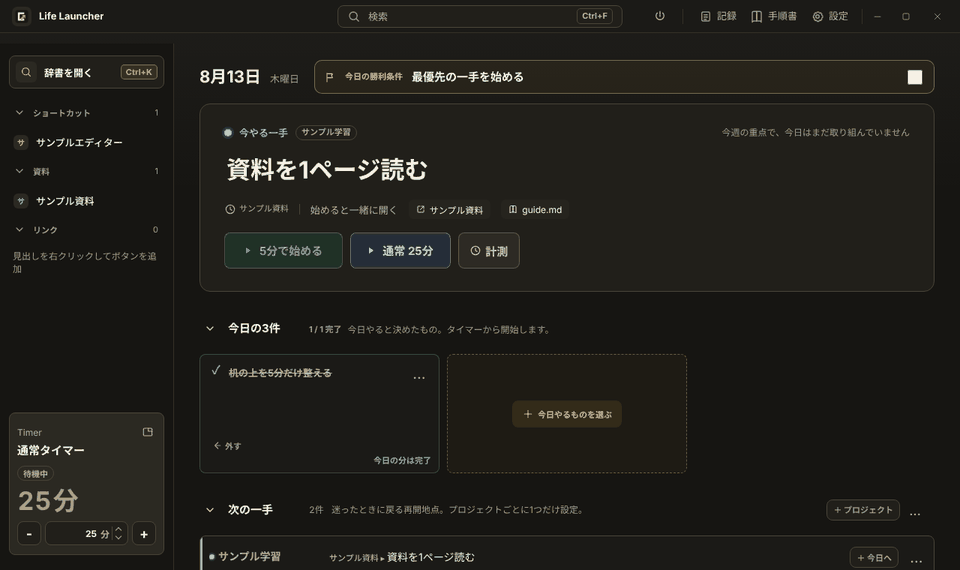
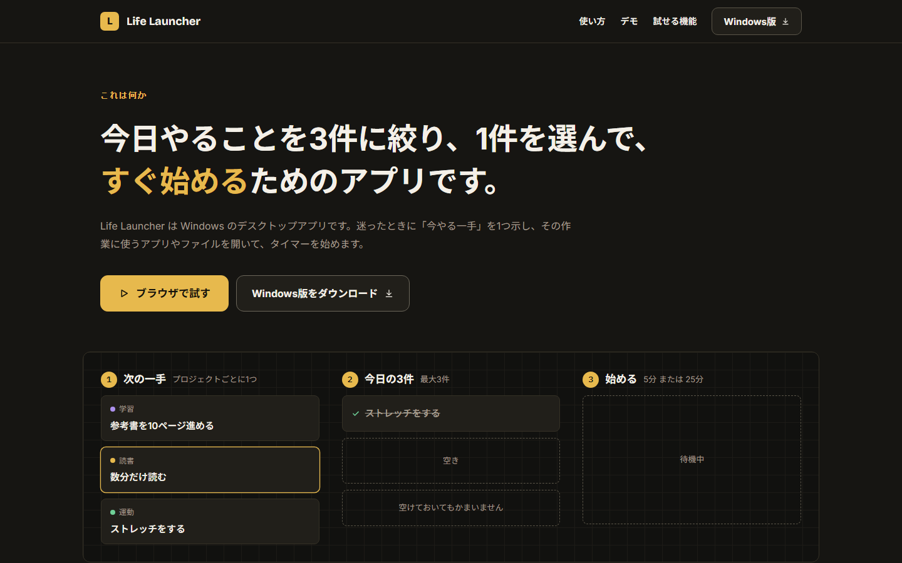
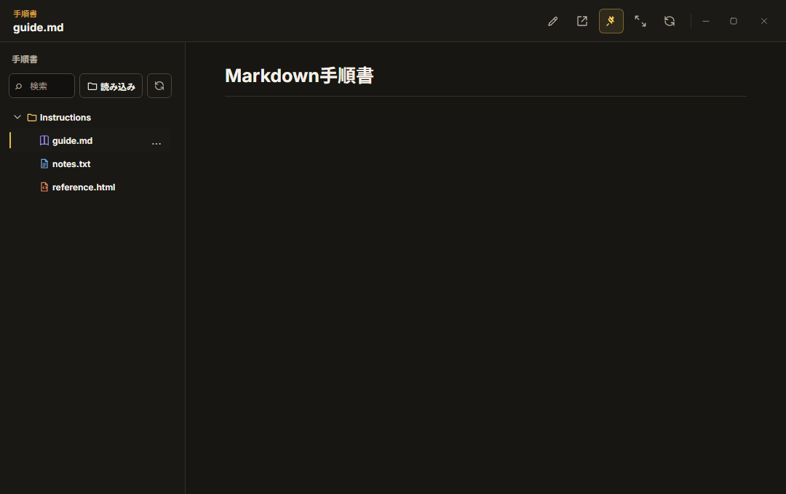

# Life Launcher

[日本語](README.md) | **English**

**A Windows app that turns “What should I do?” into “I will do this now.”**

Life Launcher is a Windows desktop app that presents one next step, opens the environment needed for it, and helps you move from deciding to starting. Your data is stored on your own PC.

[Download Life Launcher for Windows](https://github.com/Takuyakou/life-launcher/releases/latest)



<sub>Generated from synthetic data. In the real app, the apps and instructions attached to the step open as well.</sub>

## Web Demo

Try the central Life Launcher flow in your browser without installing the Windows app.

[Open the Web Demo](https://life-launcher-web.takuyakou.workers.dev)



The Web Demo uses synthetic data to demonstrate the central Life Launcher flow, including choosing today's items, running timers, and removing an item from Today's Three. Changes stay in this browser. Launching apps, files, and URLs is simulated rather than performed.

Note: it is not a complete port of the Windows product. The Web Demo has a separate publishing process and is not updated alongside the Windows desktop release.

## Highlights

### 1. Get started quickly (main screen)

- **One thing to do now.** Life Launcher suggests one action from your active projects. If you left a “Resume here” note last time, it appears under the action so you can pick up where you left off.
- **Today's Three.** Show up to three things to do today. Pick them in “Choose today's work” and reorder them by dragging or using the keyboard. Filter by project to pick several items from one project, or add a new wish and put it into Today's Three there.
- **Timers and session history.** Start a short or regular timer, or use Measure to track elapsed time. Sessions of at least one minute are recorded locally. When the timer ends, you can extend it or finish and decide on the next step. Change the extension length in the prompt or in Settings.
- **First launch and bulk import.** Start with an empty workspace, choose one thing, and give it five minutes. You can also use “Bulk Import” to add JSON that ChatGPT or Claude generated. Review the contents by project and deselect items before importing.

### 2. Open your tools and instructions quickly

- **Quick Launcher / Dictionary (`Ctrl+K`).** Register frequently used apps, folders, files, and URLs. Launch them from the sidebar or the search window using the keyboard.
- **Instruction Viewer.** Read Markdown, plain text, HTML, and MHTML files (`.mhtml` / `.mht`) from registered folders in a separate window. Read image ZIPs as books with two-page spreads, right-to-left reading, and automatic bookmarking.
- **In-app search (`Ctrl+F`).** Search across Next Steps, launcher buttons, and instructions. Search treats hiragana and katakana, full-width and half-width characters, and upper and lower case as equivalent. Press `Enter` to start a short timer or `Shift+Enter` to start a regular timer.

### 3. Plan your week

- **Plan this week.** Review last week's total time, active days, and completed items in Records. Choose up to three projects to focus on this week. Items that have been inactive for 14 days or more get a suggestion to make the next step smaller. Use the facts from your record to choose what to do next, with no ratings or scores.

### Screenshots

#### Plan this week


#### Dictionary / Instructions

| Dictionary | Instruction Viewer |
| --- | --- |
|  |  |

<sub>The screenshots use synthetic data. They contain no actual user settings, records, or paths.</sub>

### Common shortcuts

| Keys | Action |
| --- | --- |
| `Ctrl+K` / `Ctrl+F` | Open the Dictionary / Search within the app |
| `Enter` / `F2` / `Delete` | Start the selected row (make a wish a Next Step) / Edit / Delete (remove an item from Today's Three) |
| `T` (with a menu open) | Add to Today's Three |
| `Ctrl+Z` / `F1` / `Ctrl+W` | Undo / Open the guide / Close |
| `Menu key` / `Shift+F10` | Open the context menu |

<sub>In Settings, you can assign global shortcuts to show the app, toggle the mini timer, and open the Instruction Viewer.</sub>

## Download

Download the latest version from [GitHub Releases](https://github.com/Takuyakou/life-launcher/releases/latest). For changes in each version, see [GitHub Releases](https://github.com/Takuyakou/life-launcher/releases) and the [CHANGELOG](CHANGELOG.md).

| Format | Filename | Suggested use |
| --- | --- | --- |
| **Installer (recommended)** | `Life-Launcher-v<version>-windows-x64-setup.exe` | Everyday use, with Start menu registration and easy updates |
| **Standalone EXE** | `Life-Launcher-v<version>-windows-x64.exe` | Try the app without installing it |
| **Portable ZIP** | `Life-Launcher-v<version>-windows-x64-portable.zip` | Extract the app to a folder of your choice |

- **Runtime requirements.** Windows 10 or later (x64) and Microsoft Edge WebView2 Runtime.
- **Integrity check.** Use `SHA256SUMS.txt` attached to the release to verify your download.

> [!NOTE]
> - The current downloads are unsigned, so Windows SmartScreen may warn you when you launch them.
> - All editions, including the ZIP, store user data in `%APPDATA%\life-launcher`. This arrangement does not support carrying the app and its data together on a USB drive.

## Updating and Backups

The app has no automatic updater. To check for a new version, select “Open release page” under Maintenance in Settings. This opens your browser, and the app itself makes no network request.

**To update**
1. Exit Life Launcher completely.
2. Back up the `%APPDATA%\life-launcher` folder by copying it to a separate location.
3. Run the new installer (or launch the new EXE or ZIP edition).

Your settings, session history, and window positions carry over. For the design and specifications, see [OVERVIEW](docs/OVERVIEW.md) and the [current specification](docs/spec/current-spec.md).

<details>
<summary>Update notes and troubleshooting (uninstall errors / migrating from v1.2)</summary>

- **If the installer cannot uninstall the previous version.** Exit Life Launcher and try again, or select “Do not uninstall” to continue. Your settings and records are preserved.
- **If you revert to an older version.** The older version may lose settings that were introduced later, such as new colors. Restore your pre-update backup. Versions that change the data format will say so in the release notes.
- **If you update from v1.2 to v1.3 or later for the first time.** On startup, the app automatically migrates the config schema from `2` to `3`. It creates a raw backup of the original settings first. If migration, validation, or backup fails, it leaves the original settings intact. Session records are preserved.

</details>

## Privacy and Security

- **Local storage with no account required.** Settings, session records, notes, backups, and the icon cache are stored on your PC in `%APPDATA%\life-launcher` or your chosen backup location. The app has no dedicated server, cloud sync, telemetry, analytics, or crash reporting.
- **Minimal network use.** When you register a URL, the app may make a direct request to that site for its favicon. It blocks local and private destinations, rechecks redirects, and enforces timeouts and response-size limits. Tauri capabilities are scoped to each window. Automated Rust tests cover these protections.
- **JSON import safety.** Import JSON only from sources you trust. Review the contents and deselect items before importing. Immediately after an import, before making other changes, you can undo it from the notification.

See [PRIVACY.md](PRIVACY.md) and [SECURITY.md](SECURITY.md) for details.

## Development and Technical Information

- **Tech stack.** Tauri 2 / Rust / React 18 / TypeScript / Vite 8 / Zod / Motion / Playwright for deterministic visual QA.
- **Bundled assets and libraries**
  - **Fonts.** [Inter](https://github.com/rsms/inter) and [Noto Sans JP](https://github.com/notofonts/noto-cjk) (`@fontsource-variable/inter` and `@fontsource-variable/noto-sans-jp`, both under the SIL Open Font License 1.1).
  - **Animation.** [Motion](https://motion.dev/) (`motion`, MIT License).

<details>
<summary>Development setup, builds, and running with a test profile</summary>

### Requirements

- Node.js 24
- Rust stable (MSVC toolchain)

### Basic commands
```powershell
npm.cmd ci
npm.cmd run lint
npm.cmd run build
npm.cmd run test:visual
cargo check --manifest-path src-tauri/Cargo.toml
```

### Running the app in development and building Windows packages
```powershell
# Start the Tauri development app
npm.cmd run tauri -- dev

# Build a local Windows package
npm.cmd run package:windows
```

### Native testing with a separate profile

Run a test build without closing your everyday copy of Life Launcher. Settings, session records, window state, WebView2 data, and autostart are isolated.

```powershell
# Start from an empty profile, as on first launch
powershell -ExecutionPolicy Bypass -File scripts/start-test-profile.ps1 -Exe release-candidate/v<version>/Life-Launcher-v<version>-windows-x64.exe

# Start with a copy of your current settings, leaving the originals intact
powershell -ExecutionPolicy Bypass -File scripts/start-test-profile.ps1 -Exe <path-to-exe> -CopyCurrentData
```

You can also run `npm.cmd run tauri -- dev` with an absolute path in `LIFE_LAUNCHER_TEST_PROFILE`. The default location is `release-candidate/native-check/profiles/<timestamp>`. Before publishing, we run lint, build, Playwright visual QA, Rust check, test, and clippy, and the public safety scan.

</details>

## Public Source and License

The public history of this repository starts at Life Launcher v1.0.0. It contains neither the private development history nor actual user data. Specifications and verification records since publication are kept in this repository. Downloadable builds are hosted on GitHub Releases.

No open-source license is granted. The source is available to view. Use, modification, and redistribution require express permission from the copyright holder. All rights reserved.