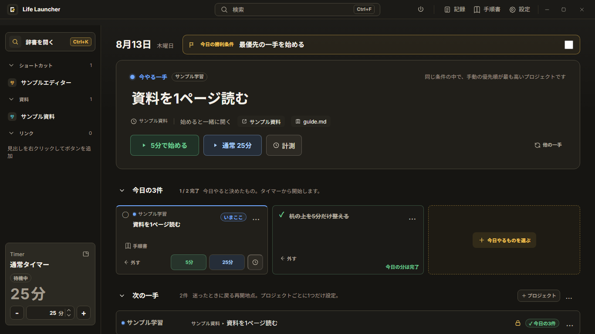
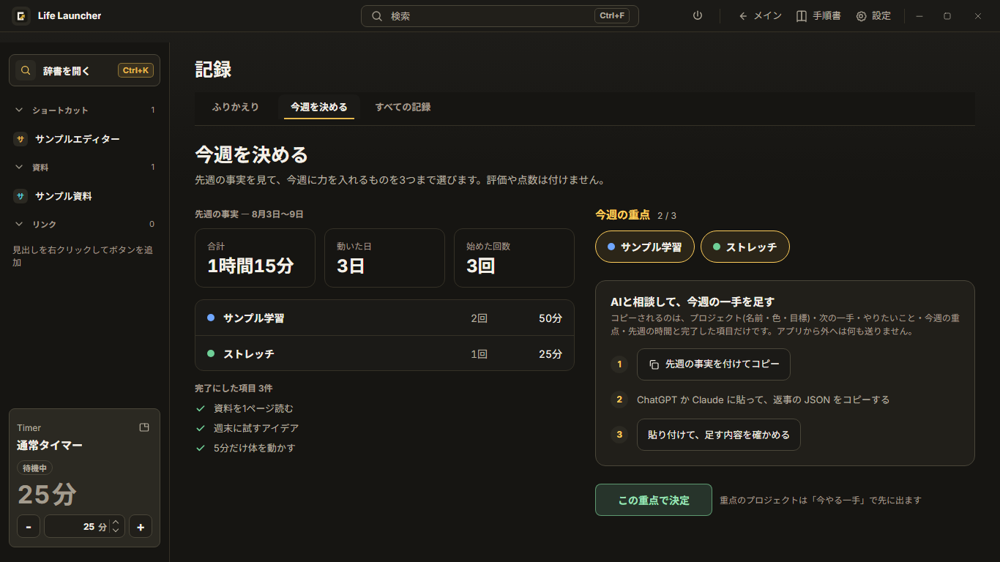
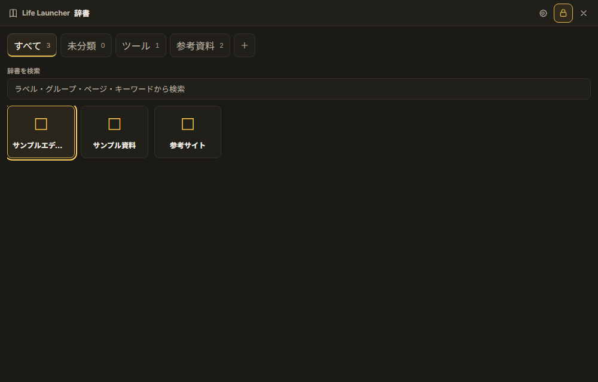

# Life Launcher

[日本語](README.md) | **English**

**A Windows app that turns “What should I do?” into “I will do this now.”**

Life Launcher is a local-first Windows desktop app that presents one next step, opens the environment needed for it, and helps you move from deciding to starting.

[Download Life Launcher for Windows](https://github.com/Takuyakou/life-launcher/releases/latest)



## Web Demo

Try the central Life Launcher flow in your browser without installing the Windows app.

[Open the Web Demo](https://life-launcher-web.takuyakou.workers.dev)


The Web Demo uses synthetic data to demonstrate the central Life Launcher flow, including choosing today's items, running timers, and removing an item from Today's Three. Changes are stored in your browser's localStorage. Launching apps, files, and URLs is simulated rather than performed.

Note: it is not a complete port of the Windows product. The Web Demo has a separate publishing process and is not updated alongside the Windows desktop release.

## Highlights

- **One thing to do now**
  Suggests one next step: the Next Step already in Today's Three first, then this week's focus, then items you have not touched today, then the oldest session. Start it right away with 5 minutes, 25 minutes, or Measure from the idle timer.

- **Today's Three**
  Limit the day to at most three items. Start from project-colored cards; an item is completed after its planned timer expires and you confirm the session. Once all three are complete, choose the next three from “Choose today's work”. Use the card's “Remove” button, its “…” menu, its context menu, or Delete on a focused card to remove only its adoption into today (the original entry and session records remain).

- **Choose today's work**
  Candidates (Next Steps and Other ideas) on the left, numbered Today slots on the right. Reorder with drag or Alt+↑/↓; the decision is saved once when you press Decide. Closing with changes asks whether to discard them. Picking a third item does not confirm automatically.

- **Other ideas**
  Grouped per project with colored lines. “▷ Make it the Next Step” promotes a row; a group whose project has no Next Step shows a “No Next Step yet” badge.

- **Search (Ctrl+F)**
  Find Next Steps, buttons, and instructions regardless of hiragana/katakana, full/half width, or letter case. Press Enter to start 5 minutes, or Shift+Enter for the normal duration.

- **First run**
  When there are no projects and no Today items, the main screen shows “Let's start just one thing”. Enter a theme and a first step, press “Start with 5 minutes”, and the app creates one project and one Next Step and starts a 5-minute timer. “Start later” leaves the empty dashboard.

- **Quick Launcher / Dictionary**
  Register apps, folders, files, and URLs, then open them from the sidebar or `Ctrl+K` search. The button builder retains drafts when switching registration modes. Navigate the dictionary with arrow keys; on multiple monitors, it opens on the same screen as the main app.

- **Timer / Session Records**
  Start a short or normal timer, or use Measure to count up from 0:00, and store sessions of at least one minute locally. Stopping early does not automatically complete today's item. When the planned time is up you can finish as is, add 5 minutes, take another step for 5 minutes, pick from Today's Three, or stop.

- **Plan this week**
  On the “Plan this week” tab of Records, review last week's total time, active days, sessions, time per project, and completed items, then choose up to three focus projects. Projects whose Next Step has stayed the same for 14 days or more appear under “Not moving lately” with “Make it smaller” and “Keep”. “Copy with last week's facts” builds a prompt for ChatGPT or Claude, and you can add the JSON reply through Bulk import. No scores or ratings.

- **View instructions**
  Read Markdown, text, sanitized HTML, and MHTML (`.mhtml` / `.mht`) files from registered folders in a separate window.

- **Keys**
  `Ctrl+K` dictionary / `Ctrl+F` search / `F1` guide / `Ctrl+W` close / on a row `Enter` start (Other ideas: make it the Next Step), `F2` edit, `Delete` remove (Today's Three: remove from today) / while a menu is open `T` add to Today's Three / `Ctrl+Z` undo / `Menu` or `Shift+F10` menu. Configure the show/hide, mini, and instructions keys in Settings.

## Screenshots

### Plan this week



### Dictionary / Instructions

| Dictionary                                                | Instructions                                                   |
| --------------------------------------------------------- | -------------------------------------------------------------- |
|  |  |

The screenshots are generated from synthetic data. They do not contain real user configuration, activity, paths, or notes.

## Download

Download Life Launcher from [GitHub Releases](https://github.com/Takuyakou/life-launcher/releases/latest). Check that page for the latest published version and filenames.

Release notes for every version are in [GitHub Releases](https://github.com/Takuyakou/life-launcher/releases) and the [changelog](CHANGELOG.md).

### Installer - Recommended

Use this for the standard installation flow.

Installer: `Life-Launcher-v<version>-windows-x64-setup.exe`

### Standalone EXE

Run the app directly without installing it.

Standalone EXE: `Life-Launcher-v<version>-windows-x64.exe`

### Portable ZIP

Extract the ZIP archive and run the app.

Portable ZIP: `Life-Launcher-v<version>-windows-x64-portable.zip`

The ZIP edition also stores user data in `%APPDATA%\life-launcher`. It does not carry your data alongside the executable on a USB drive.

> The current Windows binaries are not code-signed, so Windows SmartScreen may display a warning. Microsoft Edge WebView2 Runtime is required.

You can verify the release files with the included `SHA256SUMS.txt`.

## Updating

Fully exit Life Launcher and back up the `%APPDATA%\life-launcher` folder to another location before updating. There is no automatic updater.

The first launch after updating from v1.2 to v1.3 migrates config schema `2` to `3`. The app creates a raw pre-migration backup and leaves the original config unchanged if migration, validation, or backup fails. Session records are not deleted.

Updating to a new version keeps your current settings and records. If you go back to an older version, settings added by the newer version (for example, a new color) may be lost, so back up before updating. When a release changes the data format, the release notes will say so. The saved window position and size are also kept.

If you choose "Uninstall before installing" in the installer and it reports "Could not uninstall the previous version", quit Life Launcher and try again, or choose "Do not uninstall". Your settings and records are kept.

See [GitHub Releases](https://github.com/Takuyakou/life-launcher/releases) and the [changelog](CHANGELOG.md) for details. The [overview](docs/OVERVIEW.md) and [current specification](docs/spec/current-spec.md) cover the wider feature set. These detailed documents are currently in Japanese.

## Runtime Requirements

- Windows 10 or later (x64)
- Microsoft Edge WebView2 Runtime

## Development

### Requirements

- Node.js 24
- Rust stable with the MSVC toolchain

```powershell
npm.cmd ci
npm.cmd run lint
npm.cmd run build
npm.cmd run test:visual
cargo check --manifest-path src-tauri/Cargo.toml
```

Run the Tauri development app:

```powershell
npm.cmd run tauri -- dev
```

Build local Windows packages:

```powershell
npm.cmd run package:windows
```

A "test profile" start runs the app apart from your normal data (settings, records, window state, WebView2 data, and the autostart entry), so you do not have to close your everyday app to check a build.

```powershell
# Start from an empty profile (like a first launch)
powershell -ExecutionPolicy Bypass -File scripts/start-test-profile.ps1 -Exe release-candidate/v<version>/Life-Launcher-v<version>-windows-x64.exe

# Start with a copy of the current settings (the originals are not modified)
powershell -ExecutionPolicy Bypass -File scripts/start-test-profile.ps1 -Exe <path to the EXE> -CopyCurrentData
```

Setting `LIFE_LAUNCHER_TEST_PROFILE` to an absolute folder and running `npm.cmd run tauri -- dev` switches the same way. Without `-Profile`, the script uses `release-candidate/native-check/profiles/<timestamp>`.

Public quality checks cover React / TypeScript lint and build, Playwright Visual QA, Rust check / test / clippy, and the public safety scan.

## Tech Stack

- Tauri 2 / Rust
- React 18 / TypeScript
- Vite 8
- Playwright for deterministic Visual QA
- Zod for frontend data validation
- Motion for UI animation
- Inter and Noto Sans JP, bundled with the app (SIL Open Font License 1.1)

## Security

The public source includes bounded favicon retrieval, local and private destination rejection, redirect revalidation, response validation, and window-specific Tauri capabilities. Automated Rust tests cover the network and permission contracts.

## Local Data And Network Use

Life Launcher does not require an account or a Life Launcher server. Configuration, sessions, notes, backups, and icon cache data are stored locally under `%APPDATA%\life-launcher` or in a backup folder selected by the user.

The app has no telemetry, analytics, crash-reporting service, cloud synchronization, or automatic updater. When you register a URL, Life Launcher may fetch its favicon directly from the target origin. The fetch path rejects obvious local and private destinations and applies redirect, timeout, and response-size limits. Opening a registered URL launches your browser, whose network behavior is outside Life Launcher.

See [PRIVACY.md](PRIVACY.md) and [SECURITY.md](SECURITY.md) for details.

## Public Source

This repository starts at Life Launcher v1.0.0 with a clean public history. It does not include the original private development history or real user data. Specifications and verification records created for public development are maintained here; release binaries are hosted on GitHub Releases.

## License

No open-source license is granted. The source is visible for inspection, but use, modification, and redistribution are not permitted without the copyright holder's explicit permission. All rights reserved.
