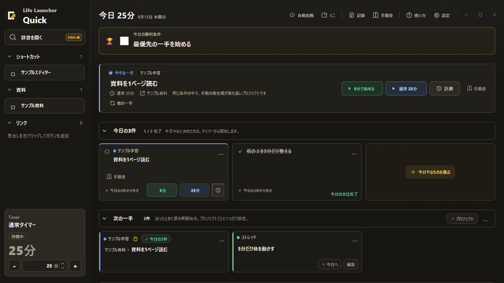
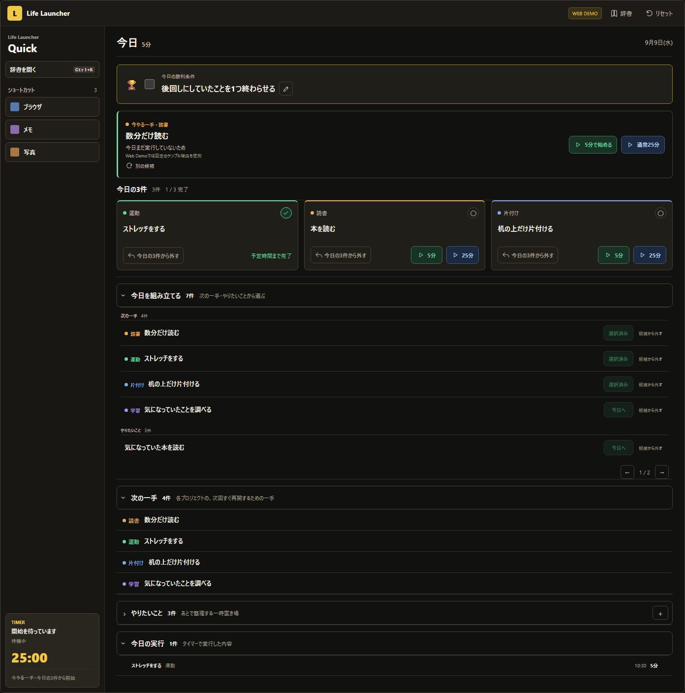
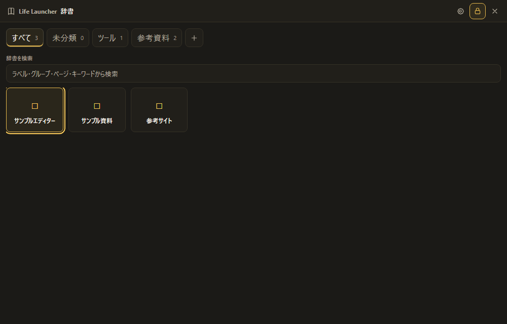
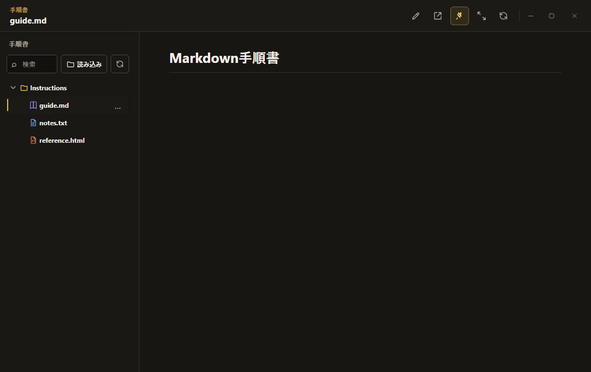

# Life Launcher

**日本語** | [English](README.en.md)

**「何をしよう？」を「今これをやる」に変えるWindowsアプリ。**

Life Launcherは、迷っているときに「今やる一手」を1つ示し、その作業に必要な環境を開いて、すぐに始められるようにするWindowsデスクトップアプリです。データは手元のPCに保存します（local-first）。

[Windows版をダウンロード](https://github.com/Takuyakou/life-launcher/releases/latest)



## Web Demo

インストールしなくても、ブラウザでLife Launcherの中心的な流れを試せます。

[Web Demoを開く](https://life-launcher-web.takuyakou.workers.dev)



Web Demoは合成データを使い、今日の候補の選択、タイマー、「今日の3件から外す」などを体験できます。変更した内容はブラウザのlocalStorageに保存します。アプリ・ファイル・URLを開く操作は実際には行わず、画面上の動きだけで確かめられます。

※Web DemoはWindows版をすべて移したものではありません。Windows版とは別に公開しているため、Windows版の更新と同時には更新されません。

## 主な機能

- **今やる一手**
  次の一手があるプロジェクトの中から、今週の重点と取り組み状況をもとに「今やる一手」を1件示します。今週の重点を選んでいなくても、候補を表示します。

- **今日の勝利条件 / 今日の3件**
  その日の基準を1つ決め、取り組む項目を最大3件に絞ります。プロジェクトの色が付いたカードから開始し、予定時間が終わったあとに終了を確定すると完了になります。3件すべてが完了したら、次の3件は自分で選びます。

- **今日やるものを選ぶ / やりたいこと**
  今日の3件の空き枠から選択画面を開き、次の一手とやりたいことの中から「＋ 今日へ」で選びます。3件目を選ぶと自動で確定し、キャンセルすると選ぶ前の状態に戻ります。選んだ項目には、そのときの本文・手順書・開始環境・タイマー分数が引き継がれ、元の項目も残ります。今日の3件から外すときは、ドラッグ中だけ表示される解除エリアか、操作メニューを使います。

- **今日の3件から外す**
  カードの左下か右クリックのメニューから、今日の3件に入れたことだけを、確認のダイアログなしで取り消せます。元の登録・候補・実行記録は残ります。そのカードのタイマーが実行中・一時停止中・満了の確認中のときは外せません。

- **Quick Launcher / 辞書**
  アプリ・フォルダ・ファイル・URLを登録し、サイドバーや`Ctrl+K`の検索から開けます。ボタンを作る画面では、登録元を切り替えても入力中の内容が残ります。辞書は矢印キーで移動でき、複数のモニターを使っているときは、本体のウィンドウがある画面に開きます。

- **タイマー / セッション記録**
  短時間・通常のタイマーか、0:00から数える「計測」で始め、1分以上実行した内容をPCに記録します。途中で終了しても、今日の項目は自動では完了になりません。この終了は、登録そのものを「完了にする」「削除」する操作とも別です。

- **手順書ビューアー**
  登録したフォルダ内のMarkdown・テキスト・サニタイズ済みHTML・MHTML（`.mhtml` / `.mht`）を、別のウィンドウで読めます。

## スクリーンショット

### 辞書 / 手順書ビューアー

| 辞書                                               | 手順書ビューア                                             |
| -------------------------------------------------- | ---------------------------------------------------------- |
|  |  |

スクリーンショットは合成データで作っています。実際のユーザーの設定・アクティビティ・パス・ノートは含まれていません。

## ダウンロード

Life Launcherは[GitHub Releases](https://github.com/Takuyakou/life-launcher/releases/latest)からダウンロードできます。公開中の最新版と配布ファイル名は、リンク先で確認してください。

各版の変更は[GitHub Releases](https://github.com/Takuyakou/life-launcher/releases)と[CHANGELOG](CHANGELOG.md)にあります。

### インストーラー（推奨）

通常はこちらを使ってください。

インストーラー: `Life-Launcher-v<バージョン>-windows-x64-setup.exe`

### 単体実行版（EXE）

インストールせずに、そのまま起動できます。

単体実行版: `Life-Launcher-v<バージョン>-windows-x64.exe`

### ZIP版（ポータブル）

ZIPを展開して使えます。

ZIP版: `Life-Launcher-v<バージョン>-windows-x64-portable.zip`

ZIP版でも、ユーザーデータは`%APPDATA%\life-launcher`に保存します。USBメモリなどにデータごと入れて持ち運ぶ使い方を想定したものではありません。

> 現在のWindows版の配布ファイルにはコード署名がないため、Windows SmartScreenの警告が出る場合があります。Microsoft Edge WebView2 Runtimeが必要です。

配布ファイルの整合性は、Releaseに含まれる`SHA256SUMS.txt`で確認できます。

## 更新について

更新する前にLife Launcherを完全に終了し、`%APPDATA%\life-launcher`フォルダーを別の場所にコピーしてバックアップしてください。自動アップデーターはありません。

v1.2からv1.3へ初めて更新するときは、config schemaを`2`から`3`へ移行します。移行の前に、変換前の設定をそのまま残すバックアップ（raw backup）を作ります。移行・検証・バックアップのどれかに失敗した場合は、元のconfigを書き換えません。実行記録（Session）は削除しません。

新しい版への更新では、今の設定と記録を引き継ぎます。古い版に戻すと、新しい版で足した設定(例: 新しい色)が失われることがあるため、更新の前にバックアップを取ることをおすすめします。データの形式が変わる版では、リリースノートに書きます。窓の位置と大きさも引き継ぎます。

インストーラーで「インストールする前にアンインストールする」を選んで「以前のバージョンをアンインストールできませんでした」と出たときは、Life Launcherを終了してからやり直すか、「アンインストールしない」を選んでください。設定と記録は消えません。

変更の詳細は[GitHub Releases](https://github.com/Takuyakou/life-launcher/releases)と[CHANGELOG](CHANGELOG.md)を見てください。機能の全体像は[OVERVIEW](docs/OVERVIEW.md)に、細かい仕様は[現行仕様書](docs/spec/current-spec.md)にまとめています。

## 動作要件

- Windows 10以降（x64）
- Microsoft Edge WebView2 Runtime

## 開発

### 開発に必要なもの

- Node.js 24
- Rust stable（MSVC toolchain）

```powershell
npm.cmd ci
npm.cmd run lint
npm.cmd run build
npm.cmd run test:visual
cargo check --manifest-path src-tauri/Cargo.toml
```

Tauriの開発用アプリを起動します。

```powershell
npm.cmd run tauri -- dev
```

ローカルで使うWindowsパッケージをビルドします。

```powershell
npm.cmd run package:windows
```

普段のデータ（設定・記録・窓の状態・WebView2・自動起動の登録）から切り離して起動する「テスト用の起動」があります。実機確認はこれを使います（普段のアプリを終了する必要はありません）。

```powershell
# 空の状態から（初回起動と同じ）
powershell -ExecutionPolicy Bypass -File scripts/start-test-profile.ps1 -Exe release-candidate/v1.4.3/Life-Launcher-v1.4.3-windows-x64.exe

# 今の設定をコピーしてから（元のファイルは変更しません）
powershell -ExecutionPolicy Bypass -File scripts/start-test-profile.ps1 -Exe <EXE のパス> -CopyCurrentData
```

`LIFE_LAUNCHER_TEST_PROFILE` に絶対パスを入れて `npm.cmd run tauri -- dev` しても同じ切り替えになります。テスト用のフォルダを省くと `release-candidate/native-check/profiles/<日時>` を使います。

公開する前に、React / TypeScriptのlintとbuild、PlaywrightのVisual QA、Rustのcheck・test・clippy、公開前の安全チェック（public safety scan）で品質を確かめています。

## 技術スタック

- Tauri 2 / Rust
- React 18 / TypeScript
- Vite 8
- Playwright（決定論的なVisual QA）
- Zod（フロントエンドのデータ検証）

## セキュリティ

公開ソースでは、faviconを取得する範囲を制限し、ローカルやプライベートな宛先への接続を拒否します。リダイレクト先の再検証とレスポンスの検証も行い、Tauriのcapabilitiesはウィンドウごとに設定しています。これらのネットワークと権限の制限は、Rustの自動テストで確かめています。

## ローカルデータとネットワーク利用

Life Launcherは、アカウントも専用サーバーも必要としません。設定・セッション・ノート・バックアップ・アイコンのキャッシュは、`%APPDATA%\life-launcher`か、ユーザーが選んだバックアップフォルダに保存します。

テレメトリ、解析、クラッシュレポート、クラウド同期、自動アップデータはありません。URLを登録すると、Life Launcherはそのサイトのfaviconを、サイトから直接取得する場合があります。取得するときは、明らかなローカルやプライベートの宛先を拒否し、リダイレクト・タイムアウト・レスポンスサイズに制限をかけています。登録したURLを開くとユーザーのブラウザが起動し、その後のブラウザの通信はLife Launcherでは管理していません。

詳細は[PRIVACY.md](PRIVACY.md)と[SECURITY.md](SECURITY.md)を見てください。

## 公開ソースについて

このリポジトリは、Life Launcher v1.0.0の時点から、新しい履歴で公開を始めました。非公開で開発していたころの履歴と、実際のユーザーデータは含めていません。公開後の仕様と検証の記録は、このリポジトリで管理しています。配布用のファイルはGitHub Releasesに置いています。

## ライセンス

オープンソースライセンスは付与されていません。ソースは閲覧可能ですが、著作権者の明示的な許可なく、使用・改変・再配布は認められません。All rights reserved.
