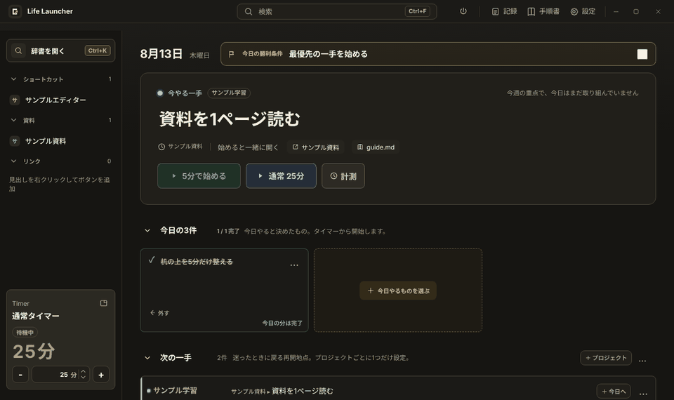
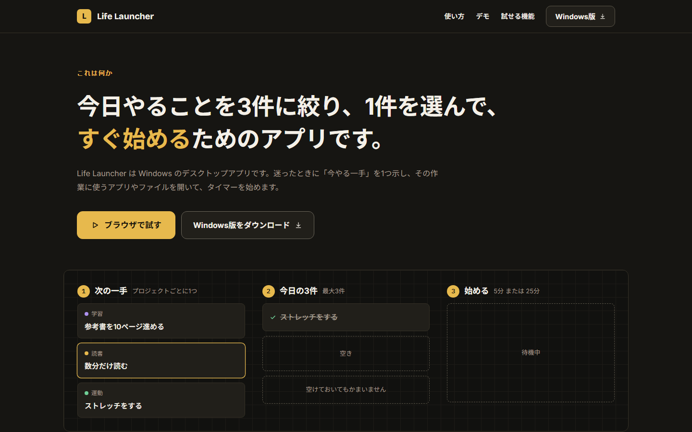
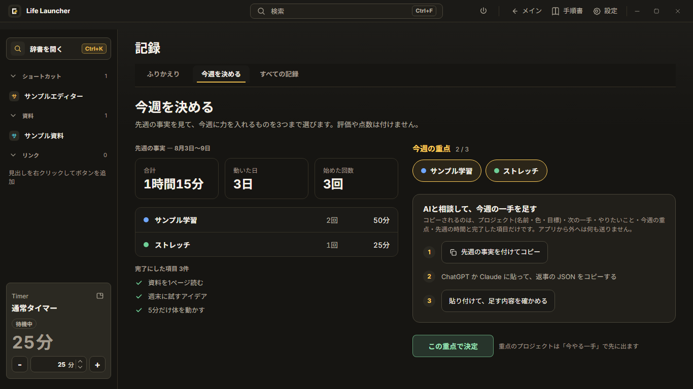
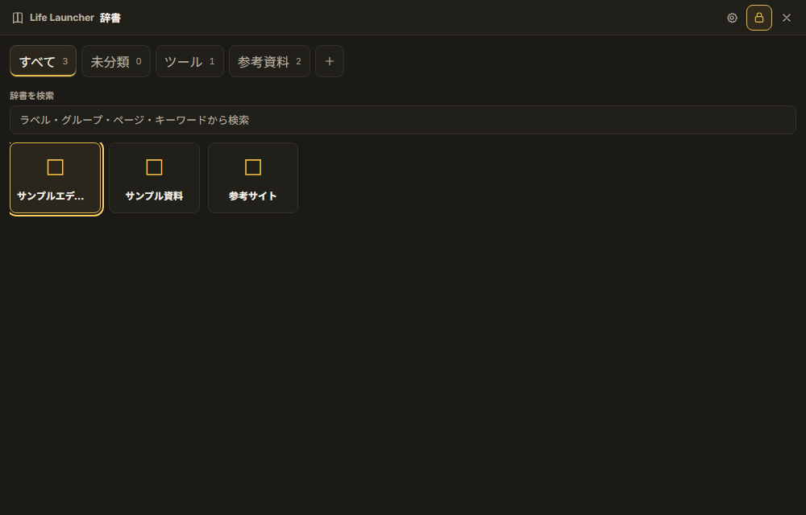
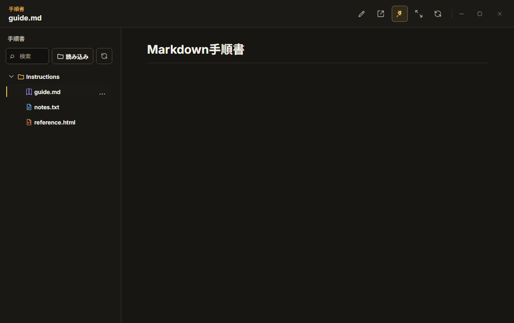

# Life Launcher

[](https://github.com/Takuyakou/life-launcher/actions/workflows/ci.yml)
[](https://github.com/Takuyakou/life-launcher/releases/latest)

**日本語** | [English](README.en.md)

**「何をしよう？」を「今これをやる」に変えるWindowsアプリ。**

Life Launcherは、迷っているときに「今やる一手」を1つ示し、その作業に必要なアプリ・ファイル・手順書をまとめて開いて、すぐに始められるようにするWindowsデスクトップアプリです。データと実行記録は手元のPCに保存し、外部のサーバーへは送りません。

[Windows版をダウンロード](https://github.com/Takuyakou/life-launcher/releases/latest) ・ [ブラウザでWeb Demoを試す](https://life-launcher-web.takuyakou.workers.dev)



<sub>合成データで作った画面です。実際のアプリでは、始めると一緒に開くアプリや手順書も開きます。</sub>

## Web Demo

インストールしなくても、ブラウザでLife Launcherの中心的な流れを試せます。

[Web Demoを開く](https://life-launcher-web.takuyakou.workers.dev)



Web Demoは合成データを使い、今日の候補の選択、タイマー、「今日の3件から外す」などを体験できます。変更した内容はこのブラウザの中に保存します。アプリ・ファイル・URLを開く操作は実際には行わず、画面上の動きだけで確かめられます。

※Web DemoはWindows版をすべて移したものではありません。Windows版とは別に公開しているため、Windows版の更新と同時には更新されません。

## 主な機能

### 1. 迷わず始める（メイン画面）

- **今やる一手**: 進行中のプロジェクトから、いま取り組むべき 1 件を自動で提案します。前回の終わりに残した「次はここから」メモも行動の下に表示されるため、再開時の迷いがありません。
- **今日の3件**: 今日やることを最大 3 件に絞って表示します。「今日やるものを選ぶ」画面で候補から選び、ドラッグやキーボードで順番を整えられます。プロジェクトで絞り込んで同じプロジェクトからまとめて選んだり、その場でやりたいことを足して今日へ入れたりもできます。
- **タイマーとセッション記録**: 短時間・通常タイマー、または経過時間を数える「計測」で着手できます。1 分以上取り組んだ内容はローカルに記録され、予定時間になったら延長して続けるか、終えて次の一手を決めるかを選べます。延長する分数は、その場でも設定でも変えられます。
- **はじめての起動 & まとめて取り込む**: 最初は何も入っていない状態から 1 つだけ選んで 5 分で始められます。ChatGPT や Claude で作った JSON を「まとめて取り込む」で一括追加することも可能です。取り込む前にプロジェクトごとに中身を確かめ、いらないものは外せます。

### 2. 作業環境と手順をすぐ開く

- **Quick Launcher / 辞書（`Ctrl+K`）**: よく使うアプリ・フォルダ・ファイル・URL を登録し、サイドバーや検索ウィンドウからキーボードだけで素早く起動できます。
- **手順書ビューアー**: 登録したフォルダ内の Markdown・テキスト・HTML・MHTML（`.mhtml` / `.mht`）を別ウィンドウで閲覧できます。画像入り ZIP は見開き・右開き・続きから開く機能を備えた「本」として読めます。
- **アプリ内検索（`Ctrl+F`）**: 次の一手・ボタン・手順書をまとめて検索できます（ひらがな／カタカナ・全角／半角・大文字／小文字を区別しません）。そのまま `Enter` で短時間、`Shift+Enter` で通常のタイマーを開始できます。

### 3. 週単位で整える

- **今週を決める**: 記録画面で先週の合計時間・動いた日数・完了した項目を振り返り、今週の重点プロジェクト（最大 3 件）を選びます。14 日以上動いていない項目は「小さくする」提案が出ます。評価や点数は付けず、事実だけをもとに次の行動を整えます。

### 画面イメージ

#### 今週を決める



#### 辞書 / 手順書ビューアー

| 辞書 | 手順書ビューアー |
| --- | --- |
|  |  |

<sub>スクリーンショットは合成データで作っています。実際のユーザーの設定・記録・パスは含まれていません。</sub>

### よく使うショートカット

| キー | 動作 |
| --- | --- |
| `Ctrl+K` / `Ctrl+F` | 辞書を開く / アプリ内を検索する |
| `Enter` / `F2` / `Delete` | 選択行を開始（やりたいことは次の一手へ） / 編集 / 削除（今日の3件は今日から外す） |
| `T`（メニュー表示中） | 「今日の3件」に入れる |
| `Ctrl+Z` / `F1` / `Ctrl+W` | 元に戻す / 使い方を開く / 閉じる |
| `メニューキー` / `Shift+F10` | コンテキストメニューを開く |

<sub>グローバル呼び出し・ミニタイマー・手順書を開くショートカットは設定画面で自由に割り当てられます。</sub>

## ダウンロード

[GitHub Releases](https://github.com/Takuyakou/life-launcher/releases/latest) から最新版をダウンロードできます。各バージョンの変更点は [GitHub Releases](https://github.com/Takuyakou/life-launcher/releases) と [CHANGELOG](CHANGELOG.md) を参照してください。

| 配布形式 | ファイル名 | おすすめの用途 |
| --- | --- | --- |
| **インストーラー（推奨）** | `Life-Launcher-v<バージョン>-windows-x64-setup.exe` | 通常の利用（スタートメニュー登録・更新が簡単） |
| **単体実行版（EXE）** | `Life-Launcher-v<バージョン>-windows-x64.exe` | インストールせずにそのまま試したいとき |
| **ZIP版** | `Life-Launcher-v<バージョン>-windows-x64-portable.zip` | 任意のフォルダに展開して使いたいとき |

- **動作要件**: Windows 10 以降（x64） / Microsoft Edge WebView2 Runtime
- **整合性の確認**: Release 添付の `SHA256SUMS.txt` で検証できます。

> [!NOTE]
> - 現在の配布ファイルにはコード署名がないため、起動時に Windows SmartScreen の警告が出る場合があります。
> - ZIP版を含め、ユーザーデータはすべて `%APPDATA%\life-launcher` に保存されます（USB メモリ等へデータごと持ち運ぶ用途は想定していません）。

## 更新とバックアップ

自動アップデーターはありません。新しい版の確認は、設定画面「メンテナンス」の「リリースページを開く」から行えます（ブラウザで開くのみで、アプリ自体は通信しません）。

**更新手順**
1. Life Launcher を完全に終了する
2. 念のため `%APPDATA%\life-launcher` フォルダを別フォルダへコピーしてバックアップする
3. 新しい版のインストーラーを実行する（または新しい EXE / ZIP を起動する）

設定・実行記録・ウィンドウ位置はそのまま引き継がれます。詳しい設計や仕様は [OVERVIEW](docs/OVERVIEW.md) と [現行仕様書](docs/spec/current-spec.md) を参照してください。

<details>
<summary>更新時の補足・トラブル対処（アンインストールエラー / 旧版 v1.2 からの移行）</summary>

- **インストーラーで「以前のバージョンをアンインストールできませんでした」と出た場合**: Life Launcher を終了してからやり直すか、「アンインストールしない」を選んで進めてください。設定と記録は消えません。
- **古い版へ戻す場合**: 新しい版で追加された設定項目（新しい色など）が失われることがあるため、更新前のバックアップから戻すことをおすすめします。データ形式が変わる版ではリリースノートに明記します。
- **v1.2 から v1.3 以降へ初めて更新する場合**: 起動時に config schema を `2` から `3` へ自動移行します。移行前に変換前の設定をそのまま残す raw backup を作成し、移行・検証・バックアップのいずれかに失敗した場合は元の設定を書き換えません。実行記録（Session）も削除しません。

</details>

## プライバシーとセキュリティ

- **ローカル完結・アカウント不要**: 設定・実行記録・ノート・バックアップ・アイコンキャッシュはすべて手元の PC（`%APPDATA%\life-launcher` または指定したバックアップ先）に保存します。専用サーバー、クラウド同期、テレメトリ、解析、クラッシュレポートはありません。
- **ネットワーク通信は最小限**: URL を登録した際、対象サイトから favicon を直接取得する場合のみ通信します。ローカル／プライベート宛先の拒否、リダイレクト再検証、タイムアウトおよびレスポンスサイズ上限を設け、Tauri の権限（capabilities）もウィンドウ単位で制限しています（Rust 自動テストで検証済み）。
- **JSON 取り込みの安全性**: 出所の分からない JSON は取り込まないでください。取り込む前に中身を確かめ、いらないものを外せます。取り込み直後（他の変更前）なら通知の「元に戻す」で取り消せます。

詳細は [PRIVACY.md](PRIVACY.md) と [SECURITY.md](SECURITY.md) を参照してください。

## 開発・技術情報

- **技術スタック**: Tauri 2 / Rust / React 18 / TypeScript / Vite 8 / Zod / Motion / Playwright（決定論的 Visual QA）
- **設計と仕様**: [全体概要とアーキテクチャ（OVERVIEW）](docs/OVERVIEW.md) / [現行のUI/UX・機能仕様書](docs/spec/current-spec.md) / [ドキュメントの目次](docs/README.md)

### 設計の見どころ

- **ウィンドウごとの最小権限**: Tauri 2 の capabilities を、メイン・辞書・手順書・ミニの4つのウィンドウごとに分けています。favicon取得の通信の守り（ローカル／プライベート宛先の拒否、リダイレクトの再検証、時間と大きさの上限）はRustで実装し、自動テストで確かめています。
- **壊れない保存と移行**: 設定は検証してから、一時ファイル経由の置き換えで保存します。旧形式からの移行では変換前のバックアップを先に作り、変換・検証・バックアップのどれかに失敗したら元のファイルを書き換えずに止めます。
- **変更のたびの自動チェック**: CIで、公開してはいけない情報の検査（秘密情報・開発環境のパス）、ESLint（警告0）、ビルド、Playwrightの画面テスト（時計を固定し、基準画像と比べる）、Rustの `cargo fmt`・`clippy -D warnings`・`cargo test`、`npm audit` を回しています。
- **待たせない操作感**: 本形式の手順書はページを裏で順に読み込み、画面は機能ごとに分けて読み込みます。「動きを減らす」設定にも合わせます。

- **同梱アセット・ライブラリ**:
  - フォント: [Inter](https://github.com/rsms/inter) / [Noto Sans JP](https://github.com/notofonts/noto-cjk)（`@fontsource-variable/inter`, `@fontsource-variable/noto-sans-jp`・いずれも SIL Open Font License 1.1）
  - モーション: [Motion](https://motion.dev/)（`motion`・MIT ライセンス）

<details>
<summary>開発環境のセットアップ・ビルド・テスト用プロファイル起動手順</summary>

### 必要な環境
- Node.js 24
- Rust stable（MSVC toolchain）

### 基本コマンド
```powershell
npm.cmd ci
npm.cmd run lint
npm.cmd run build
npm.cmd run test:visual
cargo check --manifest-path src-tauri/Cargo.toml
```

### 開発起動・Windows パッケージビルド
```powershell
# Tauri 開発用アプリを起動
npm.cmd run tauri -- dev

# ローカル用の Windows パッケージをビルド
npm.cmd run package:windows
```

### 普段のデータから切り離した実機確認（テスト用プロファイル）
普段使いのアプリを終了せず、設定・記録・ウィンドウ状態・WebView2・自動起動を完全に分離して起動できます。

```powershell
# 空の状態から（初回起動と同じ）
powershell -ExecutionPolicy Bypass -File scripts/start-test-profile.ps1 -Exe release-candidate/v<バージョン>/Life-Launcher-v<バージョン>-windows-x64.exe

# 今の設定をコピーしてから（元のファイルは変更しません）
powershell -ExecutionPolicy Bypass -File scripts/start-test-profile.ps1 -Exe <EXE のパス> -CopyCurrentData
```

`LIFE_LAUNCHER_TEST_PROFILE` に絶対パスを指定して `npm.cmd run tauri -- dev` することでも同じ切り替えができます（省略時は `release-candidate/native-check/profiles/<日時>` を使用）。公開前は lint / build / Playwright Visual QA / Rust check・test・clippy / public safety scan で品質を確認しています。

</details>

## 公開ソースとライセンス

このリポジトリは Life Launcher v1.0.0 時点から新しい履歴で公開しています（非公開開発時の履歴や実ユーザーデータは含まれていません）。公開後の仕様・検証記録は本リポジトリで管理し、配布ファイルは GitHub Releases に置いています。

オープンソースライセンスは付与されていません。ソースは閲覧可能ですが、著作権者の明示的な許可なく、使用・改変・再配布は認められません。All rights reserved.