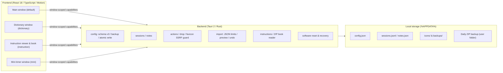

# Life Launcher Overview

- **対象バージョン**: 1.6.4
- **状態**: 現行
- **最終更新**: 2026-11-24
- **詳しい仕様**: [UI/UX・機能仕様書](spec/current-spec.md) / [ドキュメントの目次](README.md)

## 何ができるアプリか

Life Launcher は、「何をしよう？」と迷う時間をなくし、選んだ「次の一手」をすぐ実行へ移す **local-first の Windows デスクトップアプリ** です。
始めるのに必要なアプリ・URL・手順書をまとめて開き、タイマーで始め、終えたら次の再開メモと実行記録を残す流れを 1 つにつなぎます。

## システム構成



## 設計のポイント

### 1. 最小権限と通信の境界(Tauri 2 + Rust)
- **ウィンドウごとの権限**: `src-tauri/capabilities/` で、メイン・辞書・手順書・ミニの 4 つのウィンドウごとに、呼べるコマンドと権限を分けています。
- **favicon 取得の守り**: 登録した URL の favicon を取りに行く時だけ通信します。ループバック・プライベート・リンクローカル宛ての拒否、リダイレクト先の再検証、時間と大きさの上限を Rust で実装し、`cargo test` で境界の場合を確かめています。
- **JSON 取り込みの守り**: AI の答えの取り込み(`src-tauri/src/commands/import/`)は、256 KB の大きさの上限、プロジェクト 30 件・やりたいこと 100 件・文字数の上限を守り、取り込んだ後の設定全体も検証します。取り込む前に中身を選べて、取り込んだ直後は「元に戻す」で取り消せます。

### 2. ローカルのデータを壊さない
- **置き換えで保存**: `config.json` は、画面側(Zod)と Rust 側で検証してから、一時ファイル経由の置き換えで書き込みます。
- **移行前のバックアップ**: 旧形式(v2)から今の形式(v3)へ移す時は、変換前の設定を `backups/` に残してから移します。変換・検証・バックアップのどれかに失敗したら、元のファイルを書き換えずに保存を止めます。

### 3. 変更のたびの自動チェック
- **公開してはいけない情報の検査**(`scripts/check-public-safety.mjs`): 実行時データ・秘密情報・開発環境のパスが入っていないかを、全ファイルで確かめます。
- **Playwright の画面テスト**: 時計を固定し、合成データで、タイマーの動き・フォーカスの戻り・開く／閉じる動き・基準画像との差を確かめています。

### 4. 技術の選び方
- **なぜ Tauri 2 + Rust か**: 常駐するランチャーとして軽く(メモリと配布の大きさ)、ファイル・ウィンドウ・通信の境界を Rust 側で型と明示的な権限で閉じるため。
- **なぜアカウントやクラウド同期を持たないか**: 実行記録や手元のファイルのパスといった個人的なデータを PC の外に出さず、サーバーの障害やアカウントの管理なしに使い続けられるようにするため。
- **なぜ Web Demo を別のリポジトリの静的なサイトにしたか**: インストールなしで、OS を問わず(macOS・スマホも)中心の体験を試せる入口を用意しつつ、デスクトップ版の Tauri API やローカルの要件と切り離すため(通信先を持たない `connect-src 'none'` の静的配信)。

## 主な機能

### Quick サイドバー / 辞書(`Ctrl+K`)
よく使うアプリ・フォルダー・ファイル・URL は Quick サイドバーへ、増えてきたら `Ctrl+K` の辞書へ登録します。ページ分け・検索・D&D の並べ替え・キーボード操作に対応し、閉じた時のページ・フォーカス・スクロール位置を次に開いた時に戻します。

### 今日のフォーカス
「今日の勝利条件」「今やる一手」「今日の3件」で、その日に取り組む内容を最大 3 件に絞ります。「今日やるものを選ぶ」画面では、プロジェクトで絞り込みながら候補を選び、その場で「やりたいこと」を足して順番を整えられます。終わらなかった物を翌日へ自動で繰り越すことはしません。

### プロジェクト / 次の一手 / やりたいこと
プロジェクトごとに「次の一手」(迷った時に戻る再開の行動・目標・「次はここから」のメモ・開始環境・手順書・タイマーの時間)を 0〜1 件設定できます。候補は「やりたいこと」に溜め、AI の答えから「まとめて取り込む」で一度に足すこともできます。

### タイマー / 実行記録 / 週のふりかえり
短時間・通常のタイマーに加え、時間を決めずに進める「計測」があります。予定時間になったら、設定した分数(はじめは 15 分)で続けるか、「次はここから」と次の一手を決めて終えるかを選べます。1 分以上の実行は `sessions.jsonl` に記録し、記録画面の「今週を決める」で、先週の実績をもとに今週の重点(最大 3 件)を整理できます。

### 手順書ビューアー(本の形にも対応)
登録したフォルダーの Markdown・テキスト・HTML・MHTML(`.mhtml` / `.mht`)を別ウィンドウで安全に表示し、Markdown とテキストはその場で編集できます。画像を入れた ZIP は、見開き／1 ページ、右から左／左から右で本のように読め、読んだページを覚えます。

### 登録 / バックアップ / ソフトウェアリセット
ファイル・ショートカット・URL などを D&D で登録できます。日次の ZIP バックアップとアプリ内からの復元に加え、設定の「メンテナンス」から初期化(ソフトウェアリセット)ができます。実行中のタイマーは先に終え、登録先のファイルや既存のバックアップは消さず、途中で失敗しても次の起動で元に戻せます。

## 画面構成

```text
Life Launcher
├─ Main
│  ├─ Quick sidebar / Timer
│  ├─ Today dashboard(今日の勝利条件 / 今やる一手 / 今日の3件 / 次の一手 / やりたいこと / 今日の実行)
│  ├─ Records(ふりかえり / 今週を決める / すべての記録)
│  ├─ Guide
│  └─ Settings
├─ Dictionary
├─ 手順書ビューアー(通常 / 本の形)
└─ Mini Timer
```

## データの置き場所

実行時のデータはすべて `%APPDATA%\life-launcher` にローカル保存します。

| 場所 | 中身 |
| --- | --- |
| `config.json` | ランチャー・プロジェクト・次の一手・今日の3件・やりたいこと・設定(今の形式 `3`) |
| `sessions.jsonl` | タイマーと手入力の実行記録 |
| `notes.json` | 旧形式のメモの互換データ |
| `icons/` | アイコンのキャッシュ |
| `backups/` | 更新・移行の前の自動バックアップ |
| 利用者が決めたフォルダー | 日次の ZIP バックアップ |

## 意図して入れないもの

- 期限、優先度のスコア、階層のあるサブタスク、複雑なタグ
- カレンダー、ヒートマップ、連続記録(ストリーク)、ランキング、達成率
- 終わらなかった物の自動繰り越し、今日の3件や今週の重点の自動補充・自動リセット
- アプリ内の AI、自動分類、クラウド同期、アカウント、テレメトリ

## 版の履歴

公開した各版の内容は [CHANGELOG](../CHANGELOG.md) と [releases/](releases/) にあります。過去の開発段階の記録は [archive/](archive/README.md) にまとめています。

## 関連文書

- [UI/UX・機能仕様書](spec/current-spec.md) / [ドキュメントの目次](README.md)
- [ソフトウェアリセットの詳しい決まり(アーカイブ)](archive/phases/phase8.3/software-reset.md)
- [README(日本語)](../README.md) / [README(English)](../README.en.md)
- [CHANGELOG](../CHANGELOG.md) / [Privacy](../PRIVACY.md) / [Security](../SECURITY.md)
- [Screenshots](screenshots/README.md)
