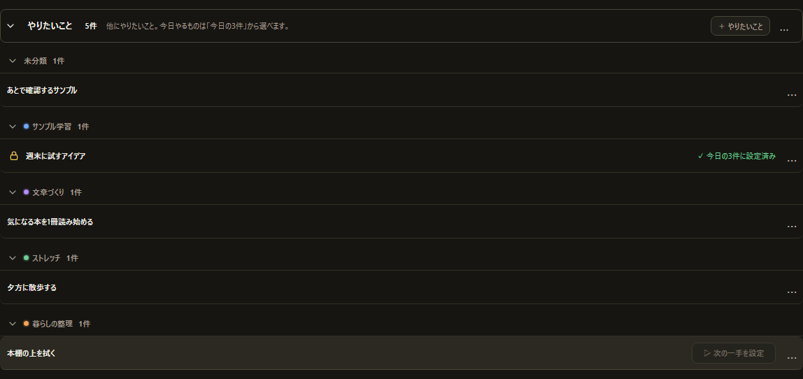
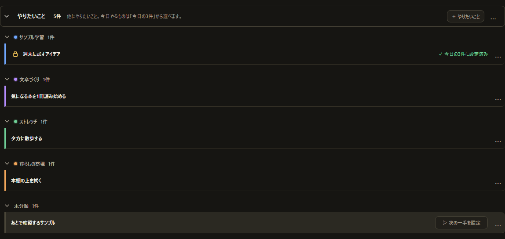

# P97-10 — 「やりたいこと」の節を見やすくする 報告

- 日付: 2026-11-08
- ブランチ: `feature/p97-10-wishlist-layout`（`main` = `3fbd8fb` から）
- 判定: **DONE**

## 実装内容の要約

「やりたいこと」の1列の並びはそのままに、グループ見出しを横線のない低い行へ変え、項目を見出しより右へ字下げしてプロジェクト色の左線を付けた。グループ間は線ではなく広めの間隔で分け、「未分類」は表示上いつも最後にした。折りたたみ・ページ送り・D&D・メニュー・十字キーの動きは変えず、仕様書と基準画像を更新した。

## 変更ファイル一覧

| ファイル | 内容 |
| --- | --- |
| `src/nextStepWishlist.ts` | `groupWishlistForDisplay()` を追加（「未分類」を最後に並べるだけ。`config.inbox` は変えない）。`reorderWishlistGroups()` で「未分類」をつかめないようにし、後ろへ落としても前に挿入する |
| `src/App.tsx` | 表示に `groupWishlistForDisplay()` を使う。グループに `data-project-color` と `wishlistGroup--unassigned` を付与。未分類の見出しはドラッグを開始せず、クリックで開閉。未分類へのドロップは前に補正 |
| `src/styles.css` | 見出しを最小30px・横線なし・`--muted`・600に。項目を10px字下げし、左に3pxのプロジェクト色線（未分類は `--line`）。本文を650に。グループ間を18pxに |
| `docs/spec/current-spec.md` | §12 の「やりたいこと」の見せ方、項目の左線、未分類の最後、グループ間の間隔、D&Dの扱いを更新 |
| `tests/visual/phase97-wishlist-layout.spec.ts` | 表示順・未分類のD&D・見た目（色線・太さ・横線なし）・十字キーの順・画像の7件 |
| `tests/visual/phase97-wishlist-layout.spec.ts-snapshots/phase97-wishlist-layout-win32.png` | 変更後の「やりたいこと」の節の基準画像（新規） |
| `tests/visual/phase82-nextstep-wishlist.spec.ts` | DOMのグループ順の期待値を、表示順（未分類が最後）に更新 |
| `tests/visual/phase84-section-empty-state-polish.spec.ts` | Wishlist行がToday/NextStepの左端から10px字下げされ、右端は同じになる、という新しい意図に更新。Today/NextStepどうしの一致はそのまま |
| `docs/phase9.7/10-wishlist-before.png` | 変更前の「やりたいこと」の節（main 3fbd8fb で撮影） |
| `docs/phase9.7/10-wishlist-after.png` | 変更後の「やりたいこと」の節（基準画像から） |
| `docs/phase9.7/10-wishlist-layout.md` | この報告 |

## 変更前と変更後

| 変更前（main） | 変更後 |
| --- | --- |
|  |  |

- 変更前は「未分類」が一番上にあり、見出しと項目の間に同じ横線があり、項目にプロジェクトの色が無かった。
- 変更後は「未分類」が一番下にあり、見出しは横線のない低い行、項目は右へ字下げして左にプロジェクト色の線が付く。グループの間は広めの間隔で分かれる。

## 完了条件ごとの結果

### 1. 表のとおりに見た目が変わった。「未分類」が最後に出る

- 見出し: `border-bottom` を外して最小30px、色を `--muted`、太さ600にした。折りたたみ矢印・色の点・名前・件数は残す。
- 項目: `.inboxList` を10px字下げし、`.inboxRow` の左に3pxの `--project-color` の線を付けた。未分類は `--line`。本文は次の一手のカードと同じ650にした（太字はやめず、次の一手と並べて自然な太さにそろえた）。
- 区切り: 同じグループ内は6pxの間隔と薄い下線、グループ間は18pxの間隔にして線を外した。
- 「未分類」: `groupWishlistForDisplay()` で常に最後。`config.inbox` の並びは表示では変えない。
- 状態・操作（「次の一手に設定」「✓ 次の一手に設定済み」「今日の3件」、ロック、「…」）は今までどおり右端。

### 2. 変えないことの一覧の動きが変わっていない

- 折りたたみ、ページ送り、項目のD&D、グループのD&D、メニュー、「次の一手に設定」、ロック、今日の3件は既存の処理のまま。
- 未分類の見出しはグループD&Dを開始しない。クリックでは今までどおり開閉する。
- ほかのグループを未分類より後ろへ落としても、未分類の前に入る。`config.inbox` が変わるのはドラッグしたときだけ。
- 十字キーの移動はDOMの順に従うため、未分類が最後になる。テストでは `.wishlistGroup` の最後が `data-wishlist-group="unassigned"` であることを確認した。

### 3. 仕様書

- `docs/spec/current-spec.md` §12 に、見出しの見た目、項目の字下げと色線、未分類の最後、グループ間の間隔、未分類のD&Dの扱い、十字キーの順を書いた。
- 「やりたいことの一覧に装飾の左線は表示しない」の記述を、今回の左線の記述に置き換えた。

### 4. 必須ゲート

下の表のとおり、ローカルで通した。

## テスト

- 表示順: `groupWishlistForDisplay()` が未分類を最後にし、`config.inbox` を変えないこと。
- グループD&D: 未分類をドラッグしても `config` が変わらないこと。未分類より後ろへ落としても、表示で未分類が最後のままであること。
- 見た目: 見出しの下線が0px、色が `rgb(184, 176, 160)`、太さ600。プロジェクト項目の左線が `rgb(112, 167, 255)`（青）、未分類が `rgb(74, 70, 57)`（`--line`）、本文が650。
- 画面: 未分類の見出しからドラッグを始めてもゴーストが出ないこと。学習グループを未分類の後ろへ落とすと、表示で未分類が最後のままであること。
- 十字キー: 未分類の見出しにフォーカスし、Shift+Tab で前のグループへ移り、Tab で未分類へ戻ることを確認した。未分類より後ろにグループが無いことの確認になる。
- 既存: `phase82-nextstep-wishlist.spec.ts` の18件がすべて成功。DOMのグループ順の期待値だけを表示順に更新した。
- 既存: `phase84-section-empty-state-polish.spec.ts` の横位置のテストを、Wishlist行の10px字下げと右端一致の新しい意図に更新した。Today/NextStepどうしの左端・右端の一致はそのまま確かめている。

## 実行したゲートと結果

| ゲート | 結果 |
| --- | --- |
| `npm run public:check` | 成功（3,652ファイル、0 blockers） |
| `npm run lint` | 成功（0エラー、0警告） |
| `npm run build` | 成功 |
| `npm run test:visual` | 648件成功（2.3分） |
| `cargo fmt --check` | 成功 |
| `cargo check` | 成功 |
| `cargo clippy --all-targets -- -D warnings` | 成功 |
| `cargo test` | 157 unit + 1 capability = 158件成功 |
| `git diff --check` | 成功 |

## 更新した基準画像の一覧と理由

| 画像 | 理由 |
| --- | --- |
| `tests/visual/phase97-wishlist-layout.spec.ts-snapshots/phase97-wishlist-layout-win32.png` | 「やりたいこと」の節の見た目を変えたため。新規（1,148×544、32,353バイト） |

ほかの画面の基準画像は変えていない。`maxDiffPixels: 12` は、CI のわずかな描画差を吸収するため（P97 pre-release と同じ扱い）。

## 判断メモ

- 「未分類」を最後にするのは表示だけ。`groupWishlist()` は保存順のまま残し、表示用の `groupWishlistForDisplay()` を別にした。グループD&Dの保存処理は保存順の関数を使うので、表示の並べ替えで `config.inbox` は変わらない。
- 未分類をドラッグの対象にしないため、未分類の見出しは `pointerdown` でドラッグを開始しない。マウスのクリックで開閉できるように、未分類だけ `click` でも開閉する。
- 未分類より後ろへ落としたときは、`reorderWishlistGroups()` と `moveWishlistGroup()` の両方で「前に挿入」に補正した。
- 項目の本文は、次の一手のカードの本文と同じ650にした。見出しは600にして、項目より一段弱くした。
- プロジェクト色は `resolveProjectColorId(project.id, project.colorId)` で決め、色を指定していないプロジェクトも次の一手のカードと同じ自動色の線になるようにした。
- グループ間の間隔は18px、グループ内の項目は6pxの間隔と薄い下線にした。1件だけのグループが並んでも、見出しと項目のまとまりが分かる。
- `phase82-nextstep-wishlist.spec.ts` のDOM順の期待値は、表示順が変わったための更新。折りたたみ・D&D・メニューなどの期待値は変えていない。

## 提案

- P97-11 の実機確認で、P97-01 のテスト用の起動を使い、やりたいことが何件かある状態（P97-09 の取り込みで足してもよい）で、見出しと項目のまとまり、未分類が最後、折りたたみ・D&D・メニュー・「次の一手に設定」、表示サイズ「特大」と最小幅を確かめる。
- プロジェクトの色の線は、次の一手のカードの3px線と同じ太さにした。実機で並べて強すぎる場合は、2pxに落とすことを検討する。
